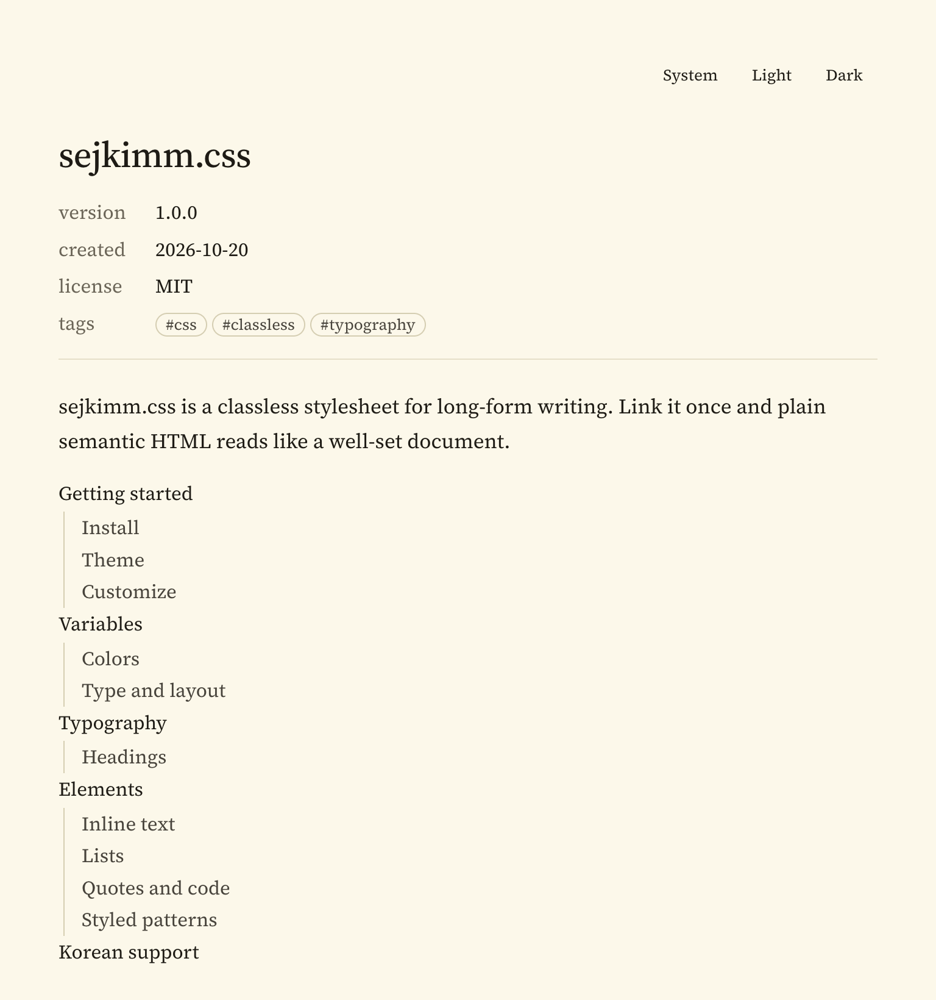
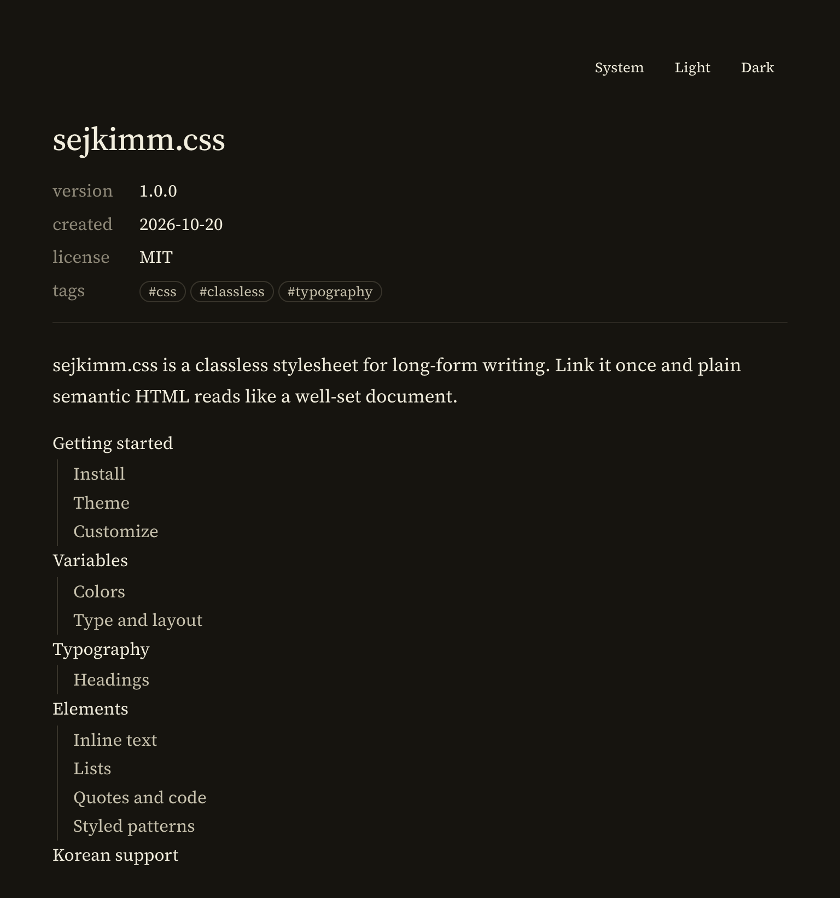
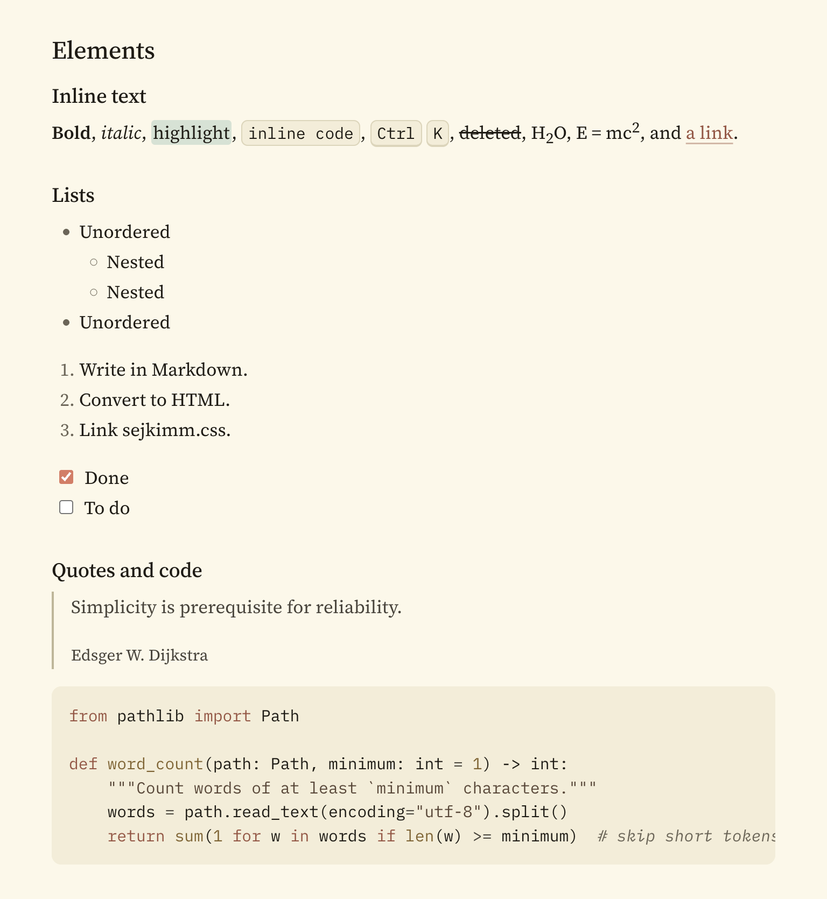
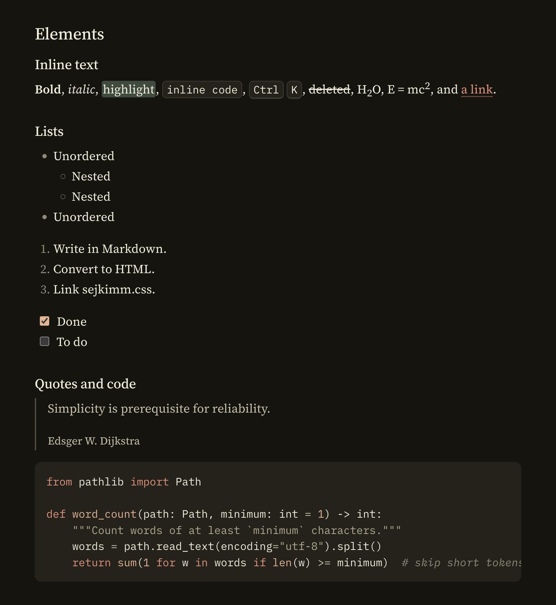

# sejkimm.css

> A design system for myself, inspired by Anthropic Claude

| Light | Dark |
| --- | --- |
|  |  |
|  |  |

## License

- [Source Serif 4](https://github.com/adobe-fonts/source-serif) by Adobe, SIL Open Font License 1.1
- [IBM Plex Mono](https://github.com/IBM/plex) by IBM, SIL Open Font License 1.1
- [Pretendard](https://github.com/orioncactus/pretendard) by Kil Hyung-jin, SIL Open Font License 1.1
- Accent colors derived from the [Color Hunt palette](https://colorhunt.co/palette/fcf8e8d4e2d4ecb390df7861) #FCF8E8 #D4E2D4 #ECB390 #DF7861

sejkimm.css is released under the [MIT License](LICENSE).
